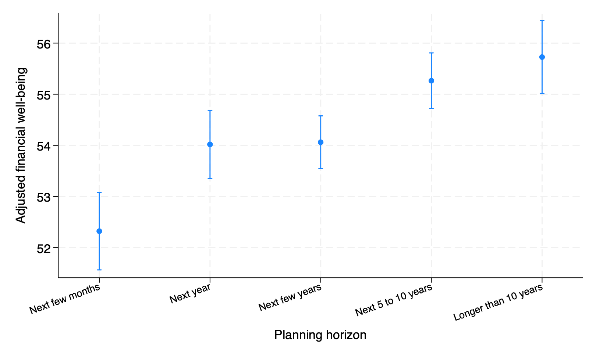

# Self-Discipline, Impulsivity, Planning Horizon, and Financial Well-Being: Evidence from the 2016 CFPB Survey

**Household Finance Lab · Project 4**
**Dataset:** CFPB 2016 National Financial Well-Being Survey (public use file), 6,219 U.S. adults
**Analysts:** Lena Gan (inference, Stata) · Sara Kay (prediction, Python)
**Files:** [DESIGN.md](DESIGN.md) · [LITERATURE.md](LITERATURE.md) · [ANALYTICAL-DECISIONS.md](ANALYTICAL-DECISIONS.md) · [CODEBOOK.md](CODEBOOK.md) · [Empirically Yours](docs/empirically-yours.md)

---

**In brief.** In weighted cross-validation targeted to the U.S. adult population, adding three short decision-related measures yielded small but consistent improvements in out-of-sample prediction of financial well-being across linear and gradient-boosting models. Conditional on measured demographics, financial knowledge, and reported financial circumstances, short self-reported indicators of goal persistence, impulsivity, and planning horizon are associated with reported financial well-being. Because the data are cross-sectional and the measures are brief self-reports, these results do not establish that changing these characteristics would improve financial well-being.

---

## 1. Why

Two households can have similar incomes and savings and feel very differently about their financial lives. Financial educators and planners need to know whether the way people approach decisions carries any information about that difference once money is accounted for.

## 2. Question

After accounting for reported financial circumstances, are self-discipline and planning horizon associated with financial well-being among U.S. adults, and do they improve prediction of an individual's financial well-being?

## 3. Framework

The planner–doer model of self-control (Thaler & Shefrin, 1981) and the behavioral life-cycle hypothesis (Shefrin & Thaler, 1988): financial outcomes depend on the ability to control impulses and plan ahead. Financial well-being has present and future components with different antecedents (Netemeyer et al., 2018; Riitsalu & van Raaij, 2022).

## 4. What is known and what is missing

On this survey, self-control has a small association with financial well-being after objective circumstances (Abt Associates, 2018), and financial knowledge has almost none once resources are held constant (Collins & Urban, 2020). Open: separating impulsivity from self-discipline, planning horizon with full controls, how much the traits add, and whether they improve prediction. Details in [LITERATURE.md](LITERATURE.md).

## 5. Expectations

Fixed before analysis (full statements and their basis in [DESIGN.md](DESIGN.md)):

- **H1** Self-discipline is positively associated with financial well-being.
- **H2** A longer planning horizon is positively associated with financial well-being.
- **H3** The traits explain added variation beyond circumstances.
- **E1 (exploratory)** Self-discipline relates more to present well-being, planning horizon to future well-being.
- **E2 (exploratory, added after preliminary runs)** Impulsivity and self-discipline relate differently to present and future well-being.

## 6. Data and measurement

- **Outcome:** the CFPB Financial Well-Being Scale score, used as published.
- **Self-discipline:** mean of "I am good at resisting temptation" and "I am able to work diligently toward long-term goals" (1–4).
- **Impulsivity:** "I often act without thinking through all the alternatives" (1–4).
- **Planning horizon:** five categories, from "the next few months" to "longer than 10 years."
- **Reported financial circumstances:** income, savings, material hardship, debt collection contact, credit denial, financial products, housing tenure, employment.
- **Controls:** financial knowledge (IRT score), age, sex, race and ethnicity, education, marital status.

All estimates use the survey weight. Standard errors are weighted Huber–White sandwich standard errors under an independence working assumption; because the public file releases no design strata or clustered PSUs, they may understate uncertainty from the original sampling design. The 6,393 degrees of freedom come from this imposed pseudo-design. Construct definitions, items, and measurement evidence are in DESIGN.md, Section 5.

## 7. Validation

| Check | Published | This study |
|---|---|---|
| Respondents | 6,394 | 6,394 |
| Weighted mean financial well-being | 54.25 (Collins & Urban, 2020) | 54.25 |
| Planning-horizon counts | codebook | identical |

The build and the main models were reproduced independently in Stata and Python.

## 8. Explanation (Stata)

**Three blocks, weighted R²:** demographics 0.169 → + circumstances and knowledge 0.491 → + decision traits 0.521.

| Variable | Coefficient (FWB points) | 95% CI |
|---|---|---|
| Self-discipline index (per scale point, 1–4) | 3.15 | 2.59 to 3.71 |
| Self-discipline index (per standard deviation) | 1.90 | |
| Impulsivity (per scale point) | −1.05 | −1.44 to −0.66 |
| Horizon: next year (vs. next few months) | 1.70 | 0.70 to 2.70 |
| Horizon: next few years | 1.74 | 0.81 to 2.67 |
| Horizon: 5 to 10 years | 2.94 | 1.98 to 3.91 |
| Horizon: longer than 10 years | 3.41 | 2.32 to 4.50 |
| Financial knowledge (control) | −0.30 | −0.77 to 0.16 |
| *Items, same model with the index replaced:* | | |
| "I am able to work diligently toward long-term goals" | 2.86 | 2.36 to 3.36 |
| "I am good at resisting temptation" | 0.38 | −0.10 to 0.86 |
| "I often act without thinking through all the alternatives" | −1.14 | −1.53 to −0.75 |

The traits add 0.030 to R² (joint test F(6, 6388) = 40.2, p < .001). For scale: the outcome's standard deviation is about 13.7 points. The self-discipline index is a pragmatic two-item measure (items correlate 0.44); the item rows show what it combines.

**Planning horizon.** Adjusted financial well-being by category, with 95% confidence intervals:

| Step | Difference | 95% CI |
|---|---|---|
| Next year vs. next few months | 1.70 | 0.70 to 2.70 |
| Next few years vs. next year | 0.04 | −0.80 to 0.89 |
| 5 to 10 years vs. next few years | 1.20 | 0.46 to 1.95 |
| Longer than 10 years vs. 5 to 10 years | 0.46 | −0.39 to 1.32 |

Well-being rises at two steps and is flat between them. A linear trend test is strong (F = 42.5, p < .001), but it is a compact descriptive summary; the categorical model is the result, and the relationship is not literally linear.

**Exploratory (standardized outcomes):**

| | Present well-being | Future well-being | Difference |
|---|---|---|---|
| Self-discipline | 0.21 | 0.30 | p < .001 |
| Impulsivity | −0.07 | −0.00 | p < .001 |
| Planning horizon | similar | similar | p = .62 |

**Robustness (self-discipline coefficient; R² added by traits):**

| Check | Coefficient | 95% CI | R² added |
|---|---|---|---|
| Primary (complete cases, n = 6,219) | 3.15 | 2.59 to 3.71 | 0.030 |
| R1 Six-item hardship | 3.10 | 2.54 to 3.66 | 0.029 |
| R2 No hardship | 3.27 | 2.69 to 3.84 | 0.036 |
| R3 Difficulty covering bills added | 2.37 | 1.85 to 2.89 | 0.016 |
| R4 "Not sure"/refused excluded | 3.32 | 2.72 to 3.91 | 0.032 |
| R6 Ages 18–61 | 2.80 | 2.17 to 3.44 | 0.029 |
| R6 Ages 62+ | 4.32 | 3.19 to 5.46 | 0.041 |
| R7 Horizon as linear term | 3.16 | 2.59 to 3.72 | 0.029 |
| R8 Unweighted | 3.53 | 3.03 to 4.04 | 0.033 |
| R9 Sensitivity analysis, assumed reliability 0.61 | 5.77 | 4.72 to 6.82 | — |
| R10 Life satisfaction added | 1.96 | 1.40 to 2.52 | 0.014 |
| R11 Multiple imputation (n = 6,389) | 3.19 | 2.63 to 3.75 | — |
| R11b Not-at-random shift of 0.5 | 3.18 | 2.61 to 3.74 | — |

R9 depends on the assumed reliability; it shows how much measurement error could matter if that value holds.

**Who was excluded.** Complete-case analysis removes 175 respondents (2.7%) who refused one or more model items. Weighted, they differ from those retained:

| | Retained | Excluded |
|---|---|---|
| Mean financial well-being | 54.3 | 53.0 |
| Income under $40,000 | 32% | 46% |
| Bachelor's degree or higher | 31% | 16% |
| Non-White | 35% | 51% |
| Savings "don't know" or refused | 19% | 49% |

Multiple imputation of the refused items leaves the estimates essentially unchanged (R11; largest fraction of missing information 0.07), and so does a not-at-random shift (R11b). Because only about 50 values per item were imputed, these checks show the results are insensitive to these refusals; they do not show the refusals are random.

## 9. Prediction (Python)

Five-fold cross-validation repeated five times (seeds 0–4), splitting individual respondents. Encoding and scaling are fitted on each training fold only; gradient-boosting settings were fixed in advance. Each held-out fold is scored with the survey weight, so performance is targeted to the weighted U.S. adult population rather than to the sampled records. Weighted R² = 1 − Σw(y − ŷ)² / Σw(y − ȳ_w); RMSE and MAE are weighted the same way.

| Model | Feature set | Weighted R² | RMSE | MAE |
|---|---|---|---|---|
| Linear | Demographics | 0.160 | 12.58 | 9.79 |
| | + Circumstances and knowledge | 0.478 | 9.92 | 7.73 |
| | + Decision traits | 0.506 | 9.65 | 7.48 |
| Gradient boosting | Demographics | 0.155 | 12.62 | 9.80 |
| | + Circumstances and knowledge | 0.495 | 9.76 | 7.56 |
| | + Decision traits | 0.521 | 9.50 | 7.34 |

**Gain from adding the traits** (mean over 25 folds; approximate interval):

| | Linear | Gradient boosting |
|---|---|---|
| R² | +0.028 (0.020 to 0.037) | +0.026 (0.017 to 0.035) |
| RMSE | −0.27 (−0.36 to −0.19) | −0.26 (−0.35 to −0.17) |
| MAE | −0.25 (−0.32 to −0.18) | −0.22 (−0.31 to −0.14) |
| Folds improved | 25 of 25 on every metric | 25 of 25 on every metric |

The intervals use a corrected resampled t (Nadeau & Bengio, 2003). They are approximate sensitivity intervals: repeated cross-validation folds reuse the same respondents, so they carry less independent information than 25 observations. The conclusion rests on the size and consistency of the gain, with the intervals as support. A reduction of about a quarter point in RMSE, on an outcome with a standard deviation of 13.7, is modest.

The gain was somewhat larger for adults 62 and older (about +0.035 in R²) than for ages 18–61 (about +0.028). In the gradient-boosting model, material hardship and savings carried the most predictive information, followed by self-discipline (descriptive permutation importance).

## 10. Findings

1. **H1, H2, H3 supported.** Among adults in similar reported circumstances, those with more self-discipline, less impulsivity, and longer planning horizons report higher financial well-being. The traits add about 3 points of explained variation and modest, consistent gains in out-of-sample prediction across folds, models, and metrics.
2. **Circumstances carry most of it.** Circumstances and demographics account for about half the variation in financial well-being; the traits add a modest share on top.
3. **One self-discipline item carries the association.** Entered separately, "I am able to work diligently toward long-term goals" is associated with 2.86 points (95% CI 2.36 to 3.36); "I am good at resisting temptation" is associated with 0.38 points, and its confidence interval includes zero (−0.10 to 0.86).
4. **Impulsivity is tied to present well-being only.** Consistent with Netemeyer et al. (2018).
5. **Self-discipline has a larger association with future well-being than with present well-being** (0.30 versus 0.21 standard deviations; the difference is significant, p < .001). E1 expected the reverse; this expectation failed.
6. **Two checks halve the association.** Adding difficulty covering bills or life satisfaction reduces self-discipline to about 2 points; it remains clearly positive.
7. **Planning horizon rises in two steps.** Well-being is higher from the next few months to the next year, flat to the next few years, and higher again at 5 to 10 years.
8. **Imputing refused items changes nothing material** (3.19 versus 3.15), but the excluded respondents are poorer and more often non-White, so these findings may describe them less well.

## 11. What it means, and what it does not

**It means:** after measured financial circumstances are considered, short self-reports of goal persistence, impulsivity, and planning horizon retain limited descriptive and predictive information about reported financial well-being.

**It does not mean:** that self-discipline causes financial well-being, that building it would raise a person's score, or that psychological measures can substitute for resources. The data are cross-sectional, circumstances account for far more of the variation, and the controls are not a full balance sheet: debt balances, net worth, and local costs are not measured.

## 12. Limitations

Cross-sectional data; controls that may themselves reflect earlier self-discipline; brief trait measures (two items, one item, one item); all measures self-reported in one survey; income and savings recorded in brackets, with no debt balances or net worth; standard errors that cannot reflect the original sampling design; excluded respondents who are financially disadvantaged and more often non-White; data from 2016; present and future subscales are our grouping. Full list in DESIGN.md, Section 9.

## 13. Methodological lesson

**Adjustment changes the question.** Without circumstances in the model, self-discipline is associated with 5.40 points; with them, 3.15. The smaller number is the association among people in similar circumstances; it is a different quantity, and controlling for circumstances that may reflect earlier self-discipline does not by itself remove bias.

**Check items before trusting a scale.** The survey's three self-control items do not form one scale, and only one of the two self-discipline items has a clear association with the outcome. An averaged score would have hidden both.

**Psychological measures are not a substitute for resources.** The study tests whether they retain limited descriptive and predictive information after measured financial circumstances are considered. They do, modestly.

## 14. Next question

Does a change in self-discipline or planning horizon precede a change in financial well-being? That needs panel data and a fuller self-control scale, which would also allow a latent-variable model.

## 15. Reproducibility

| Step | File | Software |
|---|---|---|
| Build and validate | `code/01_build.do` | StataNow 19.5 |
| Inference | `code/02_analyze.do` | StataNow 19.5 |
| Prediction | `code/03_predict.py` | Python 3.13.5; packages in `requirements.txt` |

1. Download `NFWBS_PUF_2016_data.csv` from the CFPB and place it in `data/` (see `data/README.md`).
2. From the repository root, run `code/01_build.do`; it stops if any validation check drifts.
3. Run `code/02_analyze.do`; results are written to `output/p04_results.csv`.
4. Run `python code/03_predict.py --input data/p04_analytic.csv --output-dir output`.

## License

Code: MIT (see `LICENSE`). Text, tables, and results: CC BY 4.0 (see `LICENSE-CC-BY`).

## Contributing

If you find an error, open an Issue or email householdfinancelab@gmail.com.
